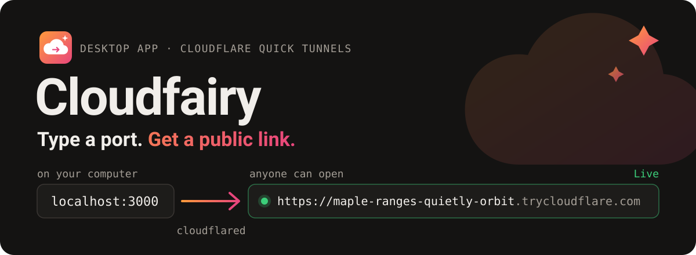
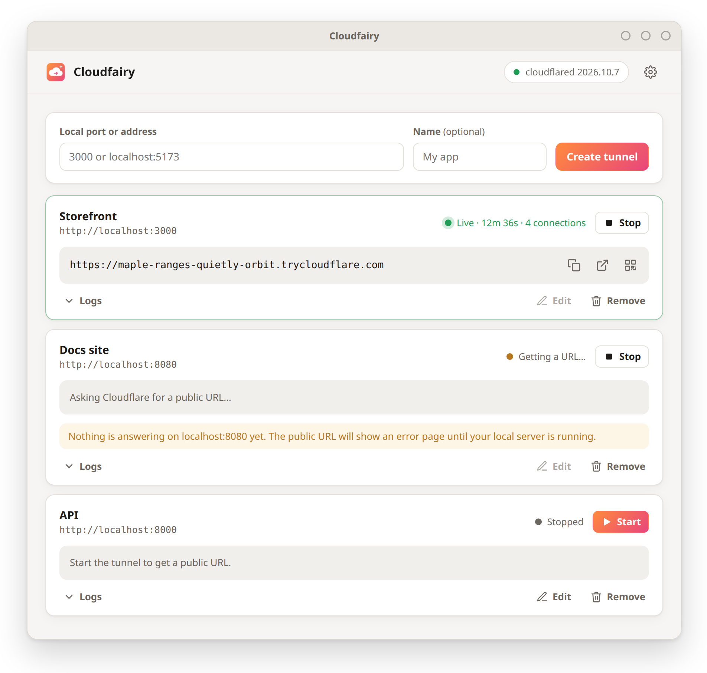
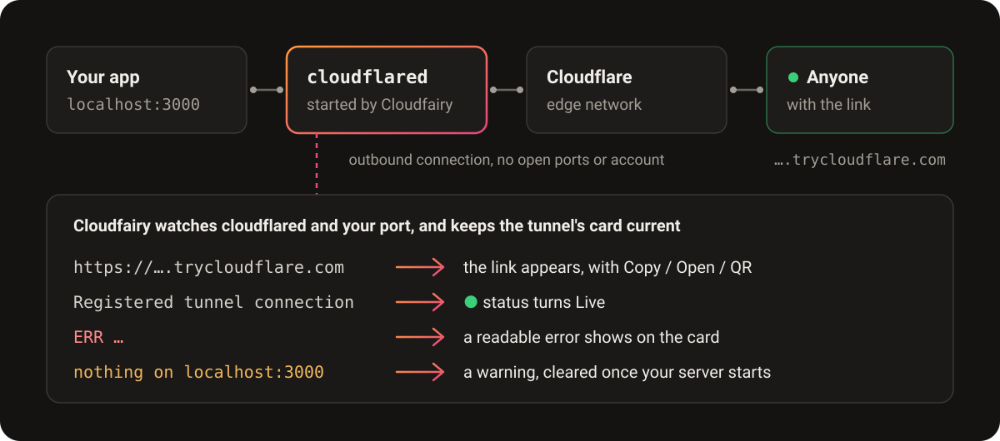

# Cloudfairy: a free Cloudflare Tunnel GUI to share localhost

<p align="center">
  <a href="https://tajbinkhan.github.io/cloudfairy/"></a>
</p>

<p align="center">
  <a href="https://github.com/tajbinkhan/cloudfairy/actions/workflows/build.yml"></a>
  <a href="https://github.com/tajbinkhan/cloudfairy/releases/latest"></a>
  
  <a href="https://v2.tauri.app"></a>
</p>

**Cloudfairy** is a free desktop app for [Cloudflare quick tunnels](https://developers.cloudflare.com/cloudflare-one/connections/connect-networks/do-more-with-tunnels/trycloudflare/).
Type a local port and get a public `https://….trycloudflare.com` link, without running
`cloudflared tunnel --url http://localhost:3000` in a terminal and copying the URL out of its logs.
You don't need a Cloudflare account or a domain.

Use it to show a dev server to a teammate, test a site on your phone, or receive webhooks on your
laptop. It works like a simple ngrok alternative, on Cloudflare's network.

<p align="center">
  <b><a href="https://github.com/tajbinkhan/cloudfairy/releases/latest">Download</a></b> ·
  <a href="https://tajbinkhan.github.io/cloudfairy/">Website</a> ·
  <a href="#build-from-source">Build from source</a> ·
  <a href="#troubleshooting">Troubleshooting</a>
</p>

<p align="center">
  <picture>
    <source media="(prefers-color-scheme: dark)" srcset="./assets/readme/app-dark.png">
    
  </picture>
</p>

## Download

Get the installer for your OS from [GitHub Releases](https://github.com/tajbinkhan/cloudfairy/releases/latest):

| Platform | Installers |
|---|---|
| Windows 10 / 11 (x64) | `.msi`, `.exe` (NSIS) |
| macOS (Apple Silicon and Intel) | `.dmg`, `.app` |
| Linux (x64) | `.deb`, `.rpm`, `.AppImage` |

You don't need to install `cloudflared` first. If Cloudfairy can't find it, one click downloads the official release.

### First launch on macOS

Cloudfairy isn't notarized by Apple yet (that needs a paid Apple Developer account), so macOS
blocks it the first time you open it. You only do this once. Later updates from inside the app
open normally.

1. Open the `.dmg` and drag Cloudfairy into Applications.
2. Open Cloudfairy. macOS says it can't verify the app. Click **Done**.
3. Open **System Settings → Privacy & Security**, scroll to **Security**, and click
   **Open Anyway** next to the Cloudfairy message. Enter your password, then click **Open Anyway** again.

On macOS 14 Sonoma and older you can instead Control-click Cloudfairy in Applications, choose
**Open**, then click **Open**.

If macOS says Cloudfairy "is damaged and can't be opened" (releases up to v0.1.6 show this),
remove the download quarantine flag in Terminal, then open the app again:

```bash
xattr -dr com.apple.quarantine /Applications/Cloudfairy.app
```

### First launch on Windows

The Windows installers aren't code-signed yet, so SmartScreen may show "Windows protected your
PC". Click **More info**, then **Run anyway**.

## Features

- **Several tunnels at once**, each with its own Start/Stop button, status, uptime and request count. Start all or Stop all with one click.
- **Any local address:** `3000`, `:8080`, `localhost:5173`, `127.0.0.1:8000/app` or `https://localhost:8443`.
- **Copy, Open in browser, or show a QR code** to open the link on your phone.
- **Checks your local server.** If nothing is listening on the port, a warning appears. It clears by itself once your server starts.
- **Readable errors.** Rate limits, crashes and a missing binary show up on the tunnel's card.
- **Live cloudflared logs** for each tunnel, with errors and warnings highlighted.
- **Request list** for each tunnel: time, method, path, status and duration of every request
  through the link. Click one to see the visitor's IP, country, user agent and request headers.
  `Authorization`, `Cookie` and other credential headers are hidden. The list lives in memory
  and keeps the last 500 requests.
- **Finds or downloads cloudflared.** It checks your Settings path first, then a copy it downloaded, then your `PATH` and the usual install locations (Homebrew, winget, Program Files).
- **Host header rewrite** per tunnel, for dev servers that reject unknown hostnames (Vite, webpack-dev-server). Turn it on under Edit.
- **Runs in the tray.** Close the window while tunnels are running and they keep running. The tray menu copies or opens each link, starts and stops tunnels, and quits.
- **Notifications** when a tunnel goes live or fails while the window is in the background. Turn on "Copy a tunnel's link when it goes live" to get each new link on your clipboard.
- **Starts with your computer, if you want.** Mark tunnels "Start when Cloudfairy opens" and turn on "Open Cloudfairy in the tray when you log in".
- **Settings:** a custom cloudflared path, and the protocol (Auto / QUIC / HTTP2). Use HTTP2 on networks that block UDP.
- **Updates itself.** When a new version is out, Cloudfairy offers to install it when it opens, then restarts. Signed updates come from GitHub Releases.
- **Tunnels are saved between launches.** Only the ones you mark start automatically, and every cloudflared process is stopped when you quit the app.

## How it works

<p align="center">
  
</p>

Cloudfairy runs `cloudflared tunnel --no-autoupdate --metrics 127.0.0.1:0 --loglevel debug --url <target>`
for each tunnel and reads its output line by line. Every two seconds it reads the request counts
from cloudflared's metrics server, which only listens on `127.0.0.1`. cloudflared only makes
outbound connections, so you don't open any ports on your router or firewall.

At debug level cloudflared logs one line for each request and one for each response, and
Cloudfairy builds the request list from them. These lines stay out of the Logs view. The response
line doesn't say which request it answers, so Cloudfairy pairs it with the oldest unanswered
request on the same connection. When several requests on one connection overlap, that pairing is
a guess, and the status shows with a `?`.

<details>
<summary><b>Code layout and where files are stored</b></summary>

```
ui/ (HTML/CSS/JS) ──invoke──▶ src-tauri/src/main.rs (commands)
        ▲                          │
        └──── events ◀──── tunnel.rs: spawns `cloudflared tunnel --metrics 127.0.0.1:0 --url <target>`
               tunnel-update         reads stdout/stderr line by line:
               tunnel-log              • URL in the banner box         → publicUrl
               download-progress       • "Registered tunnel connection" → status "running"
                                       • "ERR …"                        → error message
               app-update-progress     • "Starting metrics server on …" → metrics address
                                     polls the child process for exit → "stopped" / "error"
                                     reads /metrics every 2 s          → requests, requestErrors
                                     reports changes ──▶ background.rs: tray menu, notifications
```

| File | Purpose |
|---|---|
| `src-tauri/src/tunnel.rs` | Process lifecycle, log parsing, local-port check, input normalization |
| `src-tauri/src/cloudflared.rs` | Finding the binary, reading its version, downloading from GitHub releases (`.tgz` on macOS) |
| `src-tauri/src/app_update.rs` | Updating Cloudfairy itself: checking the latest GitHub release, downloading and verifying the signed update |
| `src-tauri/src/settings.rs` | `settings.json` persistence |
| `src-tauri/src/main.rs` | Tauri commands and app setup; kills all tunnels on exit |
| `src-tauri/src/background.rs` | Tray icon and menu, notifications, copying new links, starting tunnels on launch |
| `ui/` | The interface. Plain HTML/CSS/JS, no bundler. Follows the system light/dark theme. |
| `site/` | The project website (landing page, `robots.txt`, `sitemap.xml`, social image). [`pages.yml`](.github/workflows/pages.yml) publishes it to GitHub Pages on every push to `main` that changes it. |

| | Settings | Downloaded `cloudflared` |
|---|---|---|
| Linux | `~/.config/dev.cloudfairy.desktop/` | `~/.local/share/dev.cloudfairy.desktop/bin/` |
| macOS | `~/Library/Application Support/dev.cloudfairy.desktop/` | same folder, `bin/` |
| Windows | `%APPDATA%\dev.cloudfairy.desktop\` | same folder, `bin\` |

</details>

## Build from source

Built with Rust and [Tauri 2](https://v2.tauri.app). You need:

| | Needed |
|---|---|
| All | [Rust](https://rustup.rs) (stable) and [Node.js](https://nodejs.org) 18+ (only used to run the Tauri CLI) |
| Linux | `sudo apt install libwebkit2gtk-4.1-dev libgtk-3-dev libsoup-3.0-dev librsvg2-dev libayatana-appindicator3-dev build-essential` (or your distro's equivalents) |
| macOS | Xcode Command Line Tools: `xcode-select --install` |
| Windows | [Microsoft C++ Build Tools](https://visualstudio.microsoft.com/visual-cpp-build-tools/) ("Desktop development with C++"). WebView2 is already included in Windows 10/11. |

```bash
npm install             # installs the Tauri CLI
npm run dev             # run the app in development mode
npm run build:unsigned  # release build + installers in src-tauri/target/release/bundle/
```

`npm run build` also signs the installers for the in-app updater, so it needs the signing key
(see "CI, releases and code signing" below). Use `build:unsigned` without it.

Both build commands make installers for the OS you run it on: `.deb`, `.rpm` and `.AppImage` on Linux,
`.app` and `.dmg` on macOS, `.msi` and NSIS `.exe` on Windows.

<details>
<summary><b>CI, releases and code signing</b></summary>

Tauri doesn't cross-compile installers, so each one is built on its own OS. GitHub Actions
does this for you ([`.github/workflows/build.yml`](.github/workflows/build.yml)):

- **Every push to `main` and every pull request:** runs clippy and the unit tests on all three
  OSes. Then it builds Linux (x64), Windows (x64) and macOS (universal: Apple Silicon + Intel)
  installers and attaches them to the workflow run as artifacts.
- **Pushing a version tag** creates a draft GitHub Release with every installer attached:

  ```bash
  git tag v0.1.1 && git push origin v0.1.1
  ```

  Keep `version` in `src-tauri/tauri.conf.json` in step with the tag. Publish the draft to make
  it the latest release. Installed copies then see the update.

**Update signing.** The in-app updater only installs files signed with the project's private
key. CI reads it from the `TAURI_SIGNING_PRIVATE_KEY` repository secret, and the matching
public key is `plugins.updater.pubkey` in `src-tauri/tauri.conf.json`. If the key is lost,
installed copies can't update anymore, so keep a backup. To build signed installers locally,
set `TAURI_SIGNING_PRIVATE_KEY` to the key file's path before `npm run build`.

**macOS signing.** The macOS app is ad-hoc signed (`bundle.macOS.signingIdentity: "-"` in
`tauri.conf.json`). That needs no Apple account, and it turns Gatekeeper's "is damaged" error
into the "can't verify" prompt that users can get past with **Open Anyway**. Removing that prompt
entirely needs a Developer ID certificate and notarization (Apple Developer Program, $99 a year).

**Windows signing.** The installers aren't Authenticode-signed yet, so SmartScreen warns on
first run.

</details>

### Tests

```bash
cd src-tauri
cargo test                                         # unit tests: input parsing, log parsing, args
cargo test -- --ignored quick_tunnel_end_to_end    # real tunnel through Cloudflare (needs network + cloudflared on PATH)
```

The end-to-end test opens a tunnel to an empty port and checks that the warning appears. Then it
starts a server on that port and checks that the warning clears. It fetches the public
`trycloudflare.com` URL to confirm it reaches the local server, and stops the tunnel.

## Troubleshooting

- **macOS won't open Cloudfairy, or says it's damaged**: see [First launch on macOS](#first-launch-on-macos).
- **"429 Too Many Requests"**: Cloudflare limits how often quick tunnels can be created. Wait a minute and press Retry.
- **The tunnel fails right away and you have `~/.cloudflared/config.yml`**: cloudflared doesn't support quick tunnels while a config file exists. Rename the file while you use quick tunnels.
- **It never reaches "Live" on an office or school network**: set the protocol to HTTP/2 in Settings.
- **The URL shows a Cloudflare 502 page**: your local server isn't running, or it's on a different port.
- **Vite / webpack dev server says "Blocked request" or "Invalid Host header"**: open the tunnel's Edit dialog and turn on "Send the local address as the Host header". You can instead add `.trycloudflare.com` to the dev server's allowed hosts (for Vite, `server.allowedHosts`). Use that option if your app builds links or redirects from the Host header, because the rewrite makes them point at `localhost`.

Quick tunnels are meant for testing and sharing. They have no uptime guarantee, and the URL changes every time you start one.

## Code signing policy

The Windows installers aren't Authenticode-signed, so SmartScreen warns on first run (see
[First launch on Windows](#first-launch-on-windows)). The macOS app is ad-hoc signed and isn't
notarized.

Every release is built by GitHub Actions from a tagged commit in this repository. The build
signs the installers and `latest.json` with the Tauri update key, and the in-app updater
refuses any update whose signature doesn't match. Each release starts as a draft and is
published by hand.

| Role | Members |
|---|---|
| Committers and reviewers | [Tajbin Khan](https://github.com/tajbinkhan) |
| Release approvers | [Tajbin Khan](https://github.com/tajbinkhan) |

All team members use multi-factor authentication on GitHub.

## Privacy policy

Cloudfairy doesn't collect personal data and has no analytics or telemetry. It talks to these
servers, and only for these reasons:

- **GitHub** (`github.com`), when Cloudfairy opens, to read
  [`latest.json`](https://github.com/tajbinkhan/cloudfairy/releases/latest/download/latest.json)
  and check for a newer version. If you accept an update, it downloads the installer from
  GitHub Releases.
- **GitHub**, when you click to download cloudflared, to fetch the official cloudflared release
  from [cloudflare/cloudflared](https://github.com/cloudflare/cloudflared/releases).
- **Cloudflare**, when you start a tunnel. cloudflared connects to Cloudflare and forwards
  requests from your public link to your local server. Cloudflare's
  [privacy policy](https://www.cloudflare.com/privacypolicy/) covers that traffic.

Your tunnels and settings are stored only on your computer. The request list stays in memory
and is gone when you quit.

## License

[MIT](LICENSE)
